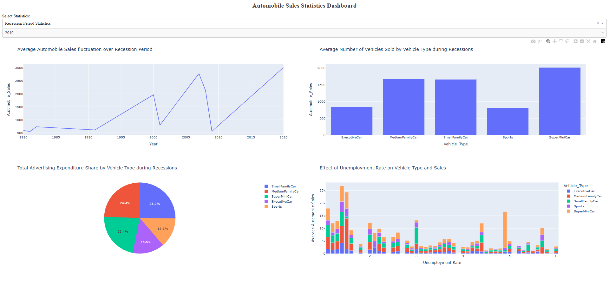
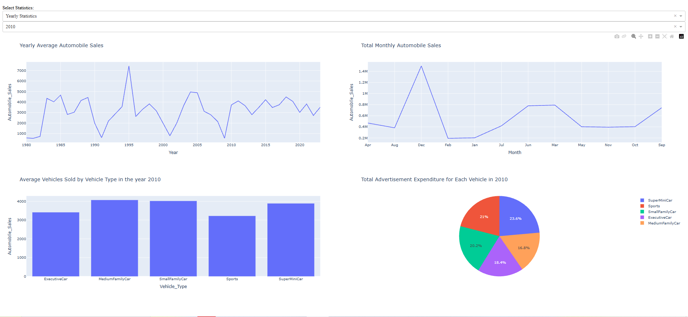

# Automobile Sales Statistics Dashboard

Interactive dashboard built with Python, Plotly and Dash as the final project of the IBM course **Data Visualization with Python** (IBM Data Analyst Professional Certificate). Final project graded **100%**.

## What it shows
**Recession Period Statistics**
- Average automobile sales over recession periods
- Average vehicles sold by vehicle type
- Share of advertising expenditure by vehicle type
- Effect of the unemployment rate on vehicle type and sales

**Yearly Statistics** (for a selected year)
- Yearly average automobile sales
- Total monthly automobile sales
- Average vehicles sold by vehicle type
- Advertising expenditure by vehicle type

## Key insights
- All vehicle types sell less during recessions, but **Sports** and **Executive** cars drop the most.
- **SuperMiniCars** hold up best in recessions, which suggests buyers switch to cheaper, more practical cars.

## Tools
Python · pandas · Plotly Express · Dash

## Screenshots



## How to run
```
pip install dash==2.17.1 pandas plotly
python automobile_sales_dashboard.py
```
Then open http://127.0.0.1:8050 in your browser.
